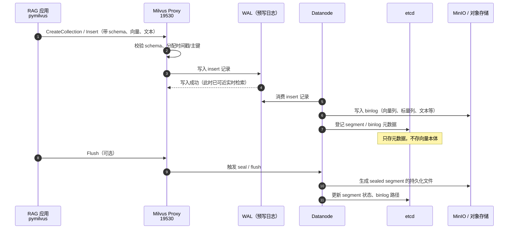
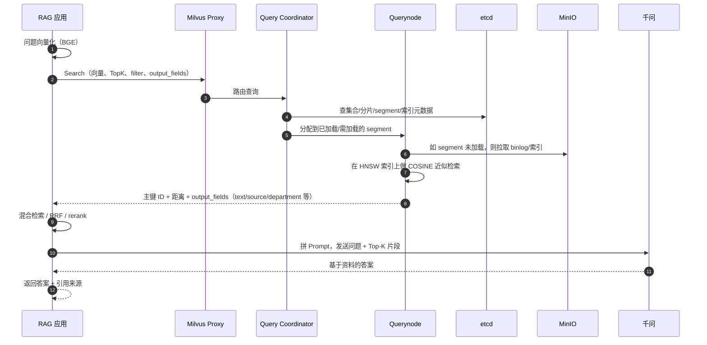

# Milvus 架构与 RAG 流程（结合本项目）

> 版本：v1.0  
> 日期：2026-10-31  
> 适用项目：`E:\Java_code\RAG-demo`（Milvus Standalone + BGE + Qwen + Flask）

---

## 0. 先修正几个关键概念

你的整体理解方向是对的：etcd 管元数据、MinIO 管对象数据、Milvus 负责请求与检索。但下面几处需要纠正，否则面试或排障时容易被追问。

| 你的表述 | 需要修正的点 | 正确理解 |
| --- | --- | --- |
| “单机 standalone 只是把 etcd、MinIO、Milvus 三个打包进一个容器” | 标准 standalone 不是这样 | Milvus Standalone 只是把 **Milvus 自身的多个角色**（proxy、coordinator、querynode、datanode、indexnode）合并到一个 `milvus-standalone` 进程/容器；**仍然依赖外部 etcd 和 MinIO**。本项目就是 3 个容器。把 etcd/MinIO 内置的是 **Milvus Lite / Embedded Milvus** 这类嵌入式形态，不是标准 standalone。 |
| “集群模式：三个独立容器，milvus 节点” | 集群不等于三个容器 | 集群模式会把 Milvus 角色拆成 proxy、各类 coordinator、多个 querynode/datanode/indexnode，通常还要接入消息队列（Pulsar/Kafka 或对应版本的 WAL 实现）。本项目是 **standalone + 外部 etcd/MinIO**，不是集群模式。 |
| “写入时先去 etcd 登记，再交给 MinIO 存文件，最后把文件路径写回 etcd” | 顺序和对象不准确 | 写入先经过 **WAL（预写日志）**；datanode 消费 WAL 后，把数据以 **binlog 列式文件**批量写入对象存储；etcd 记录的是 **集合/分片/segment/binlog 的元数据**，不是“每条向量一个文件路径”。向量本身不会进 etcd。 |
| “检索时 Milvus 查 etcd，然后去 MinIO 拉向量文件” | 不是每次查询都拉 | querynode 会提前/按需把 segment 和索引加载到内存或本地缓存；查询主要命中已加载的 **HNSW 索引**，不是每次请求都从 MinIO 拉原始文件。 |
| “Milvus 本地加载向量做余弦相似度计算” | 有索引时不是全量暴力计算 | 建了 HNSW 索引后，检索是在索引上做 **近似最近邻（ANN）** 搜索；`COSINE` 是距离度量。只有没有索引或特定场景才会更接近全量扫描。 |
| “docker 网络叫 xhzb” | 本项目不是 | 本项目的 Compose 网络名是 **`milvus`**；三个容器通过 `etcd:2379`、`minio:9000` 通信。 |
| “MinIO 存原始二进制数据” | 容易误解 | MinIO 存的是 Milvus 的 **insert binlog、delete binlog、索引文件、统计信息**；不是用户上传的 PDF/Word 原文件。原文件在本项目 `data/docs/<部门>/`。 |

---

## 1. Milvus 的三类核心组件

| 组件 | 角色 | 存什么 | 不存什么 |
| --- | --- | --- | --- |
| **etcd** | 元数据与协调中心 | 集合 schema、字段、向量维度、分片、segment 状态、binlog 路径、索引元数据、节点注册、租约、分布式锁 | 不存向量本身，不存大文件 |
| **MinIO / 对象存储** | 持久化数据层 | insert/delete binlog、索引文件、统计信息等对象文件 | 不负责服务发现、不存 schema 协调信息 |
| **Milvus 服务** | 主服务 / 计算与调度 | 接收 gRPC 请求、写入 WAL、调度 datanode/querynode、执行检索 | 不是数据库的“元数据权威源” |

### 1.1 Milvus 内部角色

| 角色 | 作用 |
| --- | --- |
| **proxy** | 对外 gRPC 入口（19530），接收 insert/search/query 请求，做路由 |
| **root coordinator** | DDL：集合、分区、索引等元数据管理 |
| **data coordinator** | 管理 datanode、segment 分配、flush |
| **query coordinator** | 管理 querynode、segment 加载与查询调度 |
| **index coordinator** | 管理 indexnode、索引构建任务 |
| **datanode** | 消费 WAL，把数据写成 binlog 并落到对象存储 |
| **querynode** | 加载 segment/索引，执行向量检索 |
| **indexnode** | 构建向量索引（如 HNSW） |

> **Standalone**：以上 Milvus 角色合并到一个 `milvus-standalone` 进程；etcd、MinIO 仍独立。  
> **Cluster**：角色拆分为独立服务，可横向扩容；通常还需要消息队列承载 WAL。

---

## 2. 单机、集群、嵌入式：到底有什么区别

| 形态 | Milvus 角色 | etcd | MinIO/对象存储 | 消息队列/WAL | 适用场景 |
| --- | --- | --- | --- | --- | --- |
| **Standalone（本项目）** | 合并在一个进程 | 外部独立 | 外部独立（本项目用 MinIO 容器） | 内置 WAL（本项目未额外配 Pulsar/Kafka） | 单机、中小数据量、内网应用 |
| **Cluster** | proxy / coordinator / querynode / datanode / indexnode 拆分 | 外部独立 | 外部独立 | 通常需要 Pulsar/Kafka 或对应版本的 WAL 实现 | 大数据量、高可用、水平扩展 |
| **Milvus Lite / Embedded** | 嵌入式库 | 内置/本地文件 | 本地文件 | 简化 | 本地开发、轻量单机，不适合生产集群 |

> **WAL 实现说明：** 不同 Milvus 版本/配置下，WAL 可能是 RocksMQ、Woodpecker、Pulsar 或 Kafka。本项目 Compose 没有额外配置消息队列，使用的是 standalone 自带的内置 WAL；集群部署通常会使用独立消息队列。

**本项目实际情况：**

```text
docker-compose.yml
├── milvus-etcd        （etcd 3.5.25）
├── milvus-minio       （MinIO RELEASE）
└── milvus-standalone  （Milvus 3.0.5，standalone）
        └── 内部包含 proxy / coordinator / querynode / datanode / indexnode
网络：milvus
端口：19530（gRPC）、9091（健康检查/监控）、9000/9001（MinIO）
```

所以本项目准确叫法是：**Standalone 部署 + 外部 etcd + 外部 MinIO**，不是“三个容器组成集群”。

---

## 3. 写入流程：从 RAG 代码到 MinIO（修正版）



### 3.1 逐步解释

1. **创建集合**  
   RAG 代码连接 `localhost:19530`，调用 `create_collection`，写入集合 schema（字段、向量维度、索引参数）。这些元数据由 root coordinator 写入 etcd。

2. **写入数据**  
   `insert` 到达 proxy 后，proxy 校验 schema，把数据写入 **WAL**。  
   - WAL 是“先记账，再慢慢落盘”的机制，保证写入不丢、写入与持久化解耦。  
   - Standalone 使用内置 WAL；集群通常使用 Pulsar/Kafka 等。

3. **datanode 消费 WAL**  
   datanode 从 WAL 读取数据，按列组织成 binlog 文件，写入对象存储（MinIO）。  
   - 向量、文本、标量字段都在 binlog 中，按 segment 批量存储。  
   - 不是“每条向量一个文件”，也不是“把 PDF 原文件存进 MinIO”。

4. **etcd 记录元数据**  
   etcd 记录 segment 状态、binlog 路径、索引信息、节点注册等。  
   - **向量本体不在 etcd**：etcd 是小型、强一致的 KV，适合元数据和协调，不适合海量向量。  
   - etcd 里更准确的是“segment/binlog 的元数据”，不是“每条向量的文件路径”。

5. **索引构建**  
   indexnode 对 sealed segment 构建索引（本项目是 HNSW），索引文件同样写入对象存储，元数据登记到 etcd。

6. **flush / seal**  
   flush 会把内存中的增量数据封装成 sealed segment，持久化后 querynode 才能更高效地加载和检索。

---

## 4. 检索流程：从问题到 Top-K（修正版）



### 4.1 逐步解释

1. **问题向量化**  
   RAG 程序用与入库相同的 embedding 模型把问题转成向量。本项目使用 `BAAI/bge-small-zh-v1.5`，查询侧会加 BGE 推荐前缀。

2. **发送 Search 请求**  
   请求包含：查询向量、`limit`、`filter`、`output_fields`、`search_params`（如 HNSW 的 `ef`）。  
   本项目还会带部门过滤：`department in ["公共", "研发部"]`。

3. **proxy → query coordinator → querynode**  
   query coordinator 根据 etcd 中的集合、分片、segment 元数据，把请求路由到对应 querynode。

4. **querynode 加载数据**  
   如果 segment/索引已经在内存或本地缓存中，直接检索；如果尚未加载，才从对象存储拉取。  
   **不是每次查询都去 MinIO 拉文件**。

5. **执行 ANN 检索**  
   本项目建了 HNSW 索引，检索是在索引上做近似最近邻搜索，距离度量是 COSINE。  
   不是把全量向量拉出来逐个算余弦相似度（那是暴力扫描，索引的意义就是避免它）。

6. **返回结果**  
   Milvus 返回主键 `id`、距离 `distance`，以及请求的 `output_fields`。  
   本项目直接请求了 `text`、`source`、`department`、`doc_id`，所以拿到结果就能拼 Prompt，不需要再按 ID 回查原文。

7. **RAG 后处理**  
   本项目不是只做一次向量检索，而是：
   - 向量召回 Top-15；
   - jieba + BM25 关键词召回 Top-15；
   - RRF 融合；
   - BGE cross-encoder 重排 Top-8 → Top-3；
   - 拼 Prompt 调千问；
   - 返回答案 + 引用。

---

## 5. 配置变更、扩缩容、节点故障


- Milvus 各节点通过 etcd 的 **watch** 机制感知配置和状态变化。
- etcd 通过 **租约（lease）** 判断节点是否存活；节点挂掉后，租约过期，元数据变化会触发调度。
- 分布式锁用于保证同一时间只有一个节点执行某些协调动作。
- 这就是为什么 etcd 是 Milvus 集群的“协调中心”：它不是存向量的，而是存“谁在做什么、数据在哪、状态如何”。

---

## 6. 本项目的真实拓扑

```text
Windows 11
├── Docker Desktop（Hyper-V 后端）
│   └── docker compose（网络名：milvus）
│       ├── milvus-etcd        :2379（仅容器网络）
│       ├── milvus-minio       :9000 / :9001
│       └── milvus-standalone  :19530 / :9091
│
├── Python 3.13 + venv
│   ├── Flask + Waitress（Web 应用，:8000）
│   ├── fastembed BGE-small-zh-v1.5（本地 ONNX）
│   ├── BGE reranker base（本地 ONNX，约 279MB）
│   ├── RapidOCR + pypdfium2（扫描件 OCR）
│   ├── jieba + BM25
│   └── SQLite data/app.db（用户/文档元数据/会话/审计）
│
├── data/docs/<部门>/（原始文档）
├── volumes/etcd、volumes/minio、volumes/milvus（Docker 数据）
└── 阿里云百炼 Qwen3.8-max（只接收问题 + Top-K 片段）
```

### 6.1 本项目的集合 schema

Web 版集合：`rag_docs`

| 字段 | 类型 | 说明 |
| --- | --- | --- |
| `id` | INT64，主键，auto_id | Milvus 自动生成 |
| `vector` | FLOAT_VECTOR，dim=512 | BGE-small-zh-v1.5 向量 |
| `text` | VARCHAR(4096) | 切片文本 |
| `source` | VARCHAR(256) | 文件名 |
| `department` | VARCHAR(64) | 部门（公共/研发部/财务部等） |
| `doc_id` | VARCHAR(64) | 文档 ID，用于精确删除/覆盖 |

索引：**HNSW，M=16，efConstruction=200，metric=COSINE**。  
检索参数：`ef=64`。

> 命令行版使用独立集合 `rag_demo`，与 Web 版互不影响。

---

## 7. 本项目的 RAG 具体流程

下面按“上传文档 → 提问 → 回答”走一遍真实代码路径。

### 7.1 上传与入库

```text
用户上传文件
  ↓
POST /api/upload-jobs
  ↓
后台 worker：读取临时文件
  ↓
extract_text()
  ├── TXT/MD：解码
  ├── DOCX：python-docx
  └── PDF：pypdf 文本层；文本过少的页面 → pypdfium2 渲染 → RapidOCR
  ↓
chunk_text()：固定窗口 + overlap
  ↓
Embedder.embed()：BGE-small-zh-v1.5 → 512 维向量
  ↓
service.ingest()
  ├── 确保集合 rag_docs 存在（schema + HNSW 索引）
  ├── 删除同 source + department 的旧切片
  ├── 批量 insert（vector/text/source/department/doc_id）
  └── flush
  ↓
SQLite documents 表写入文档元数据
  ↓
原文件保存到 data/docs/<部门>/<文件名>
  ↓
前端进度条显示：解析/OCR → 切片 → 向量化 → 写入 Milvus → 完成
```

对应代码：

- `app.py` → `extract_text()`、`_extract_pdf_text()`、`_ocr_pil_image()`
- `app.py` → `RagService.ingest()`
- `rag_demo.py` → `chunk_text()`、`Embedder`
- `app.py` → `process_upload_job()`

### 7.2 提问与检索

```text
用户问题
  ↓
Embedder.embed_query()：加 BGE 查询前缀 → 512 维
  ↓
Milvus.search()
  ├── collection=rag_docs
  ├── limit=15（HYBRID_DENSE_TOP_N）
  ├── filter=department in ["公共", 用户部门]
  ├── output_fields=id/text/source/department/doc_id
  └── metric=COSINE, ef=64
  ↓
Milvus.query()：取当前用户可见部门的全部切片文本，用于 BM25
  ↓
jieba 分词 + BM25Okapi → Top-15 关键词候选
  ↓
RRF 融合：1 / (60 + rank) → 去重排序
  ↓
BGE reranker（cross-encoder）对 Top-8 打分 → 取 Top-3
  ↓
build_prompt()：把 Top-3 片段拼进 Prompt
  ↓
ask_llm()：调用 Qwen3.8-max
  ↓
返回答案 + 引用来源
```

对应代码：

- `app.py` → `RagService.answer()`
- `app.py` → `tokenize_text()`、`keyword_coverage()`
- `app.py` → `RagService._rerank()`
- `rag_demo.py` → `build_prompt()`
- `rag_demo.py` → `ask_llm()`

### 7.3 相关性判断与兜底

```text
向量最高分 ≥ 0.35 或 关键词覆盖率 ≥ 0.5？
  ├── 是：走标准 RAG（只基于资料回答）
  └── 否：调用千问通用知识回答，并标注“不是企业资料”
          ↓
      如果模型回答“资料中没有提到”
          ↓
      自动二次调用千问通用回答兜底
```

### 7.4 一个真实例子

问题：

```text
Milvus 为什么需要 etcd？
```

本项目的实际检索结果（节选）：

```json
{
  "retrievalMode": "hybrid+rerank",
  "bestScore": 0.6128,
  "sources": [
    {
      "source": "milvus.md",
      "department": "公共",
      "matchedBy": "both",
      "cosine": 0.6102,
      "rrfScore": 0.0325,
      "rerankScore": 4.7081
    },
    {
      "source": "milvus.md",
      "department": "公共",
      "matchedBy": "both",
      "cosine": 0.5275,
      "rrfScore": 0.0318,
      "rerankScore": 1.1275
    },
    {
      "source": "milvus.md",
      "department": "公共",
      "matchedBy": "both",
      "cosine": 0.6128,
      "rrfScore": 0.0323,
      "rerankScore": -1.826
    }
  ]
}
```

说明：

- 3 条来源都是「混合召回」：向量和 BM25 都命中。
- 最终顺序由 reranker 决定，而不是单纯按余弦相似度排序。
- 第 3 条余弦分最高（0.6128），但重排分较低（-1.826），所以排在后面。
- 千问拿到的 Prompt 只包含这 3 条片段，不包含整个知识库。

### 7.5 为什么本项目还要 BM25 / rerank

| 问题 | 纯向量检索 | 本项目的混合检索 |
| --- | --- | --- |
| 编号、缩写、专有名词 | 可能漏掉 | BM25 精确命中 |
| 同义表达、长问题 | 表现好 | 向量继续负责语义 |
| 多个候选的精细排序 | 只有余弦分 | cross-encoder 逐对打分 |
| 可解释性 | 只有相似度 | 展示召回方式 + 余弦 + RRF + 重排分 |

---

## 8. 高频面试问答（结合本项目修正）

### Q1：为什么 Milvus 不用 MySQL，要用 etcd？

**A：** etcd 是分布式强一致 KV，基于 Raft，天然适合：

- 服务发现与节点注册；
- 配置同步；
- 分布式锁；
- 租约/TTL 与故障感知；
- watch 机制，让所有节点实时感知变化。

Milvus 的元数据访问模式是“小数据、高频、强一致、需要 watch”，不是复杂的业务表关联。MySQL 适合业务数据（用户、订单、报表），但不适合做集群协调中心；而且引入 MySQL 会增加一套运维依赖。

### Q2：为什么不用本地磁盘，要用 MinIO？

**A：** 向量数据量大，集群多节点需要共享同一份 segment/binlog 和索引文件。对象存储（MinIO/S3/OSS）提供：

- 共享访问；
- 海量文件存储；
- 副本/纠删码与持久化；
- 与计算节点解耦，便于扩容。

本地磁盘可以作为 querynode 的缓存，但不应作为多节点集群的唯一数据源。  
本项目虽然是单机，也保留 MinIO，因为它是 Milvus 的标准依赖，后续可以平滑换成 S3/OSS。

### Q3：为什么向量不直接存 etcd？

**A：** etcd 适合小体积元数据，不适合大对象：

- 向量维度高、数量大，写入 etcd 会迅速膨胀；
- etcd 基于 Raft，所有写都要复制，存大对象会严重拖慢集群；
- etcd 的设计目标是协调，不是存储。

所以：**向量/文本 → 对象存储 binlog；元数据 → etcd。**

### Q4：WAL 是什么？为什么需要？

**A：** WAL（Write-Ahead Log，预写日志）先把写入记录下来，再由 datanode 异步消费、落对象存储。

- 保证写入可靠性；
- 写入和持久化解耦；
- 支撑近实时检索（数据先进 WAL，querynode 可以较快看到）；
- 集群模式下通常由 Pulsar/Kafka 等承担。

### Q5：Standalone 和 Cluster 到底差在哪？

**A：**

- **Standalone**：Milvus 的 proxy、coordinator、querynode、datanode、indexnode 合并在一个进程；仍然需要外部 etcd + MinIO。适合单机、中小规模。
- **Cluster**：角色拆分为独立服务，可横向扩容；需要 etcd + 对象存储 + 消息队列，组件更多、运维更复杂。
- **Milvus Lite/Embedded**：嵌入式形态，本地文件存储，功能/规模有限，不是标准 standalone。

### Q6：Milvus 检索时每次都去 MinIO 拉数据吗？

**A：** 不是。querynode 会加载 segment 和索引到内存/本地缓存；只有 segment 尚未加载或缓存失效时才从对象存储拉取。查询主要是在已加载的 HNSW 索引上做 ANN 搜索。

---

## 9. 常见误区清单

- ❌ “Standalone 把 etcd、MinIO、Milvus 打包进一个容器”  
  ✅ Standalone 只合并 Milvus 角色；etcd/MinIO 仍独立。Milvus Lite 才是嵌入式。

- ❌ “三个容器就是集群”  
  ✅ 本项目的三个容器是 standalone + etcd + minio；集群需要拆分 Milvus 角色并增加消息队列。

- ❌ “向量存在 etcd 里”  
  ✅ 向量在对象存储 binlog 中；etcd 只存元数据。

- ❌ “每次查询都去 MinIO 拉文件”  
  ✅ querynode 会缓存/预加载 segment 和索引。

- ❌ “检索就是全量算余弦”  
  ✅ 建了 HNSW 后是近似最近邻索引搜索。

- ❌ “Milvus 返回文本 ID 后还要回查原文”  
  ✅ 可以在 `output_fields` 里直接请求 `text/source/department`，本项目就是这么做的。

- ❌ “MinIO 存的是用户上传的 PDF/Word”  
  ✅ MinIO 存 Milvus 的 binlog/索引；原文件在本项目 `data/docs/`。

---

## 10. 本项目相关命令与配置

### 10.1 启动 Milvus

```bash
docker compose up -d
docker compose ps
curl http://localhost:9091/healthz
```

### 10.2 查看三个容器

```bash
docker ps --format "table {{.Names}}\t{{.Status}}\t{{.Ports}}"
```

### 10.3 关键配置

```ini
MILVUS_URI=http://localhost:19530
WEB_COLLECTION=rag_docs
COLLECTION_NAME=rag_demo
```

### 10.4 集合与索引

```text
collection: rag_docs
fields: id, vector(512), text, source, department, doc_id
index: HNSW
metric: COSINE
M: 16
efConstruction: 200
search ef: 64
```

### 10.5 混合检索参数

```ini
HYBRID_DENSE_TOP_N=15
HYBRID_BM25_TOP_N=15
RRF_K=60
RERANK_TOP_N=8
TOP_K=3
RAG_SCORE_THRESHOLD=0.35
KEYWORD_COVERAGE_THRESHOLD=0.5
```

---

## 11. 一句话总结

**etcd 是图书馆的登记簿和调度系统，MinIO 是书库，Milvus 是管理员。**  
管理员不会把每本书的内容抄到登记簿里，也不会每次读者来都去书库搬书——它查登记簿找到书架，提前把书放到阅览区，再用索引快速帮读者找到最相关的几本。

而本项目的 RAG 流程是：

**上传 → OCR/解析 → 切片 → 向量化 → Milvus（etcd 元数据 + MinIO binlog）→ 向量 + BM25 召回 → RRF → rerank → Prompt → 千问 → 带引用的答案。**

---

*本文档结合 `E:\Java_code\RAG-demo` 的实际代码与配置编写。*
