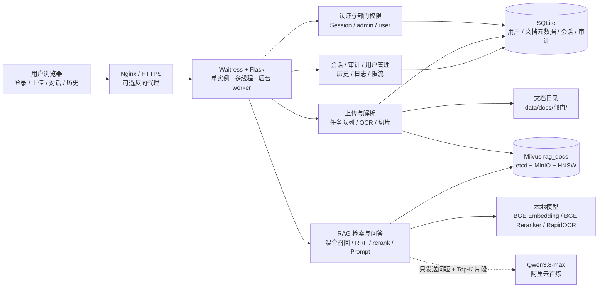
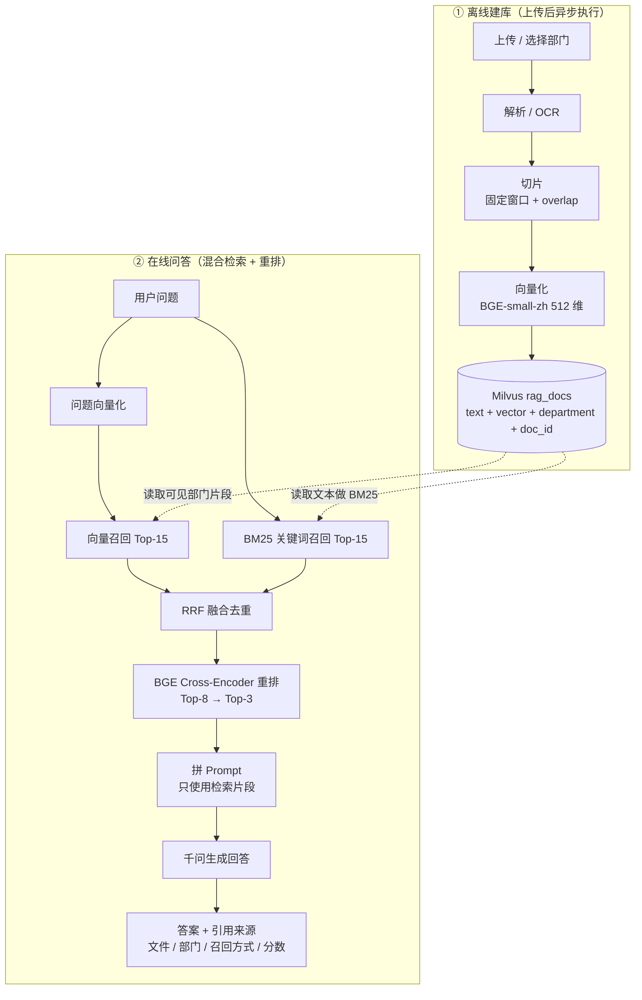
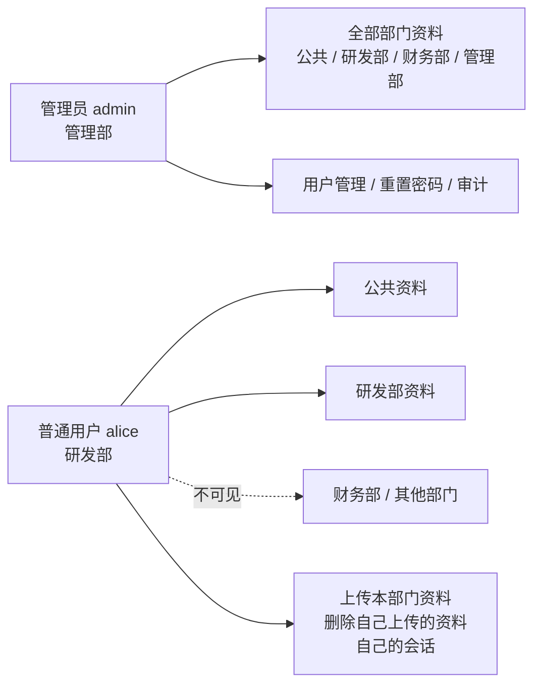
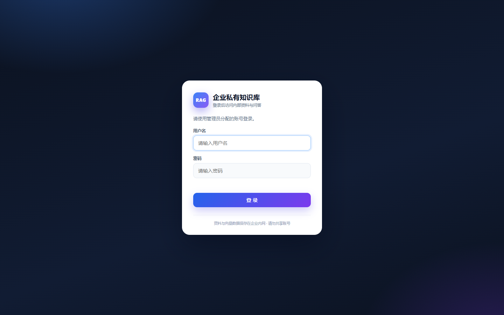
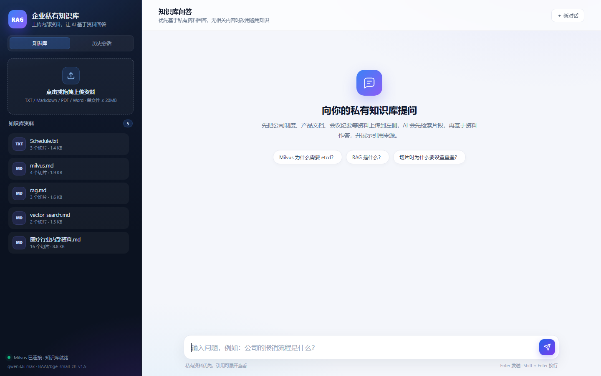
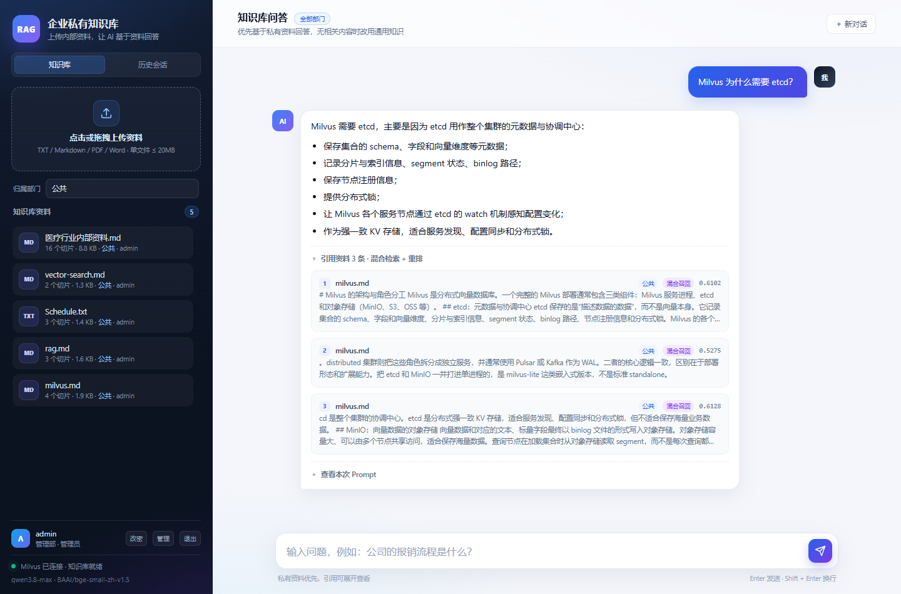
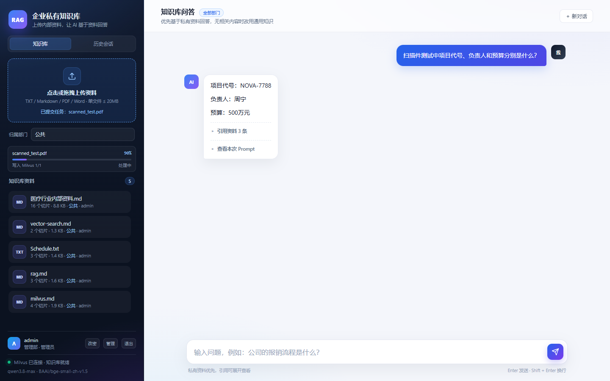
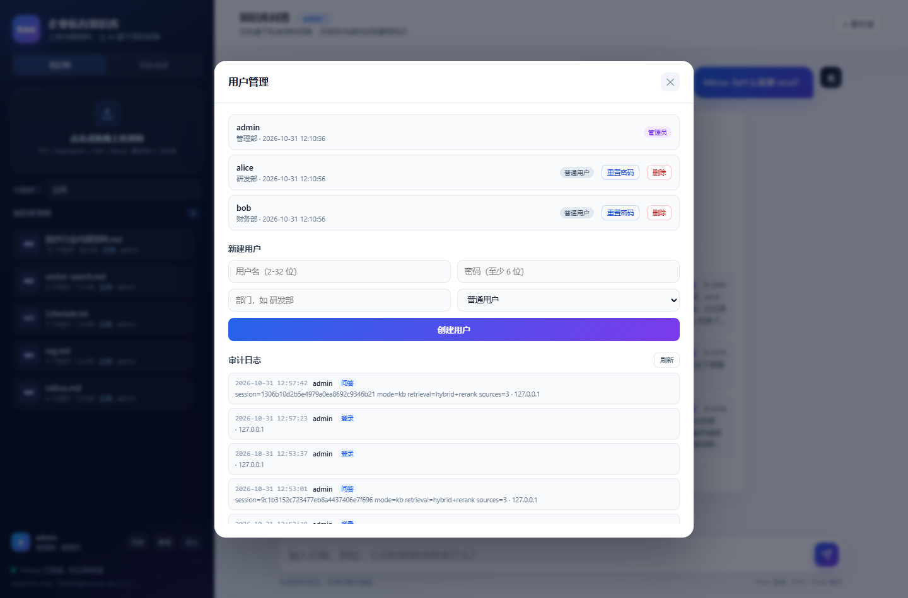
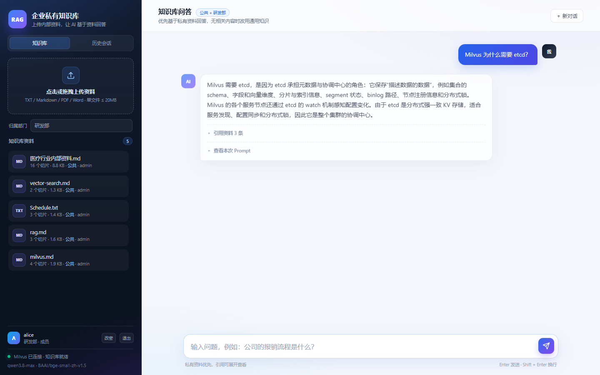
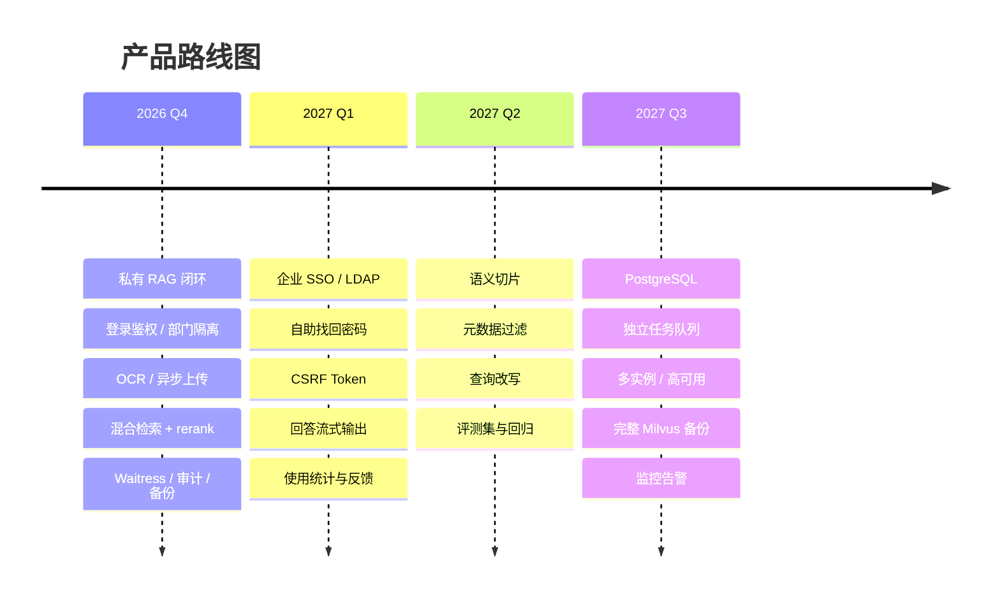

# 企业私有知识库 RAG 平台 · 项目介绍

> **版本**：v1.0  
> **日期**：2026-10-31  
> **形态**：私有化 Web 应用（Windows + Docker + Waitress）  
> **状态**：可运行 / 可验收  
> **在线文档**：[HTML 版](project-overview.html) · [PDF 版](企业私有知识库-RAG平台-项目介绍.pdf)

---

## 目录

- [1. 项目摘要](#1-项目摘要)
- [2. 背景与问题](#2-背景与问题)
- [3. 产品定位与目标用户](#3-产品定位与目标用户)
- [4. 功能全景](#4-功能全景)
- [5. 系统架构](#5-系统架构)
- [6. RAG 数据流](#6-rag-数据流)
- [7. 混合检索与重排](#7-混合检索与重排)
- [8. 权限与部门隔离](#8-权限与部门隔离)
- [9. 技术栈](#9-技术栈)
- [10. 部署架构](#10-部署架构)
- [11. 界面展示](#11-界面展示)
- [12. 安全与运维](#12-安全与运维)
- [13. 测试与验收](#13-测试与验收)
- [14. 未来规划](#14-未来规划)
- [15. 风险与限制](#15-风险与限制)
- [16. 交付清单](#16-交付清单)
- [17. 结论](#17-结论)

---

## 1. 项目摘要

**一句话：让企业内部资料“找得到、答得准、可追溯、可管控”。**

企业知识散落在 PDF、Word、扫描件和共享盘里；通用大模型不了解内部资料，直接提问容易编造；公开搜索无法访问私有数据。本项目用私有化 RAG 把“闭卷考试”变成“开卷考试”：

1. 文档上传后自动解析 / OCR、切片、向量化，写入 Milvus；
2. 用户提问时，先做向量 + BM25 双路召回，RRF 融合后由 BGE reranker 精排；
3. 取 Top-3 片段拼成 Prompt，交给千问生成回答；
4. 回答展示文件名、部门、召回方式、相似度 / 重排分；
5. 登录、角色、部门隔离、会话隔离、限流、审计、备份全部具备。

当前运行数据：**5 份知识文档、28 个切片、4 个部门、3 个系统用户**。

---

## 2. 背景与问题

| 痛点 | 具体表现 |
| --- | --- |
| 资料分散 | 制度、产品文档、会议纪要分布在 PDF、Word、扫描件、共享盘 |
| 查找低效 | 关键词搜索无法理解“报销标准是多少”这类自然语言问题 |
| 大模型幻觉 | 通用模型不知道企业内部事实，直接回答容易编造 |
| 权限缺失 | 不同部门资料不能互相可见，公开搜索工具无法满足私有化要求 |

**为什么普通方案不够：**

- 只用大模型：没有内部知识，回答不可信，也无法给出出处。
- 只用关键词搜索：无法处理同义表达、长问题和跨段落信息。
- 直接上传公有云：数据出境，权限和审计不可控。
- 传统知识库：需要人工整理目录和标签，维护成本高。

---

## 3. 产品定位与目标用户

面向中小企业内网的私有知识问答平台，强调中文、私有化、低门槛和可管控。

| 角色 | 典型诉求 | 系统提供的能力 |
| --- | --- | --- |
| 企业管理员 | 管理用户、部门、资料和审计；确保数据不越权 | 全部资料可见；创建/删除用户、重置密码；审计日志；上传公共资料 |
| 部门成员 | 快速查找本部门和公共制度、产品资料 | 自然语言问答；公共 + 本部门检索；上传本部门资料；查看自己的会话 |
| 知识维护者 | 持续上传新文档、替换旧版本、补充扫描件 | 异步上传进度；同名同部门覆盖；扫描 PDF OCR；单文档删除 |

**核心价值：** 私有化、中文优化、引用可追溯、权限可管控。

---

## 4. 功能全景

### 知识资产管理

- 支持 TXT、Markdown、PDF、Word (.docx)
- 扫描版 PDF 自动 OCR（RapidOCR）
- 异步上传任务 + 实时进度条
- 同名同部门自动覆盖旧切片
- 按部门存储：`data/docs/<部门>/`
- 单文档删除，向量同步删除

### 企业问答

- 向量 + BM25 双路召回
- RRF 融合 + BGE cross-encoder 重排
- 回答只基于检索片段，展示 Top-3 引用
- 无相关内容时调用千问通用知识，并明确标注
- 可展开查看实际 Prompt
- 多轮会话、历史会话恢复

### 组织与权限

- 账号密码登录 + Session Cookie
- admin / user 两种角色
- 普通用户只看「公共 + 本部门」
- 上传强制归本部门（后端校验）
- 会话按用户隔离，越权返回 404
- 管理员用户管理、重置密码

### 运维与审计

- 登录失败限流（5 次 / 10 分钟 → 锁定 10 分钟）
- 审计日志：登录、上传、删除、用户管理、问答元数据
- 备份脚本：SQLite + 文档 + 会话密钥
- Waitress 生产模式 + Nginx/HTTPS 示例
- 健康检查：Milvus、集合、模型、检索模式

---

## 5. 系统架构



**架构说明：**

- 浏览器只访问 Web 应用，不直接接触 Milvus 或模型。
- 文档、向量、用户、会话、审计都在企业侧。
- 千问只接收问题与最终 Top-K 片段，不接收整个知识库。
- Milvus 由 Docker Compose 管理：etcd 存元数据，MinIO 存对象数据，standalone 提供 gRPC 19530。

---

## 6. RAG 数据流



**离线建库：**

1. 上传文件并选择归属部门（普通用户固定本部门）。
2. PDF 先读文本层；文本过少的页面渲染成图片交给 RapidOCR。
3. 按固定窗口 + overlap 切片，保留上下文。
4. 用 BGE-small-zh-v1.5 生成 512 维向量。
5. 写入 Milvus，切片带 `source`、`department`、`doc_id`。

**在线问答：**

1. 问题向量化，按用户可见部门检索 Top-15。
2. 同时用 jieba + BM25 做关键词召回 Top-15。
3. RRF 融合去重，再用 BGE reranker 对 Top-8 精排。
4. 取 Top-3 拼 Prompt，调用千问生成回答。
5. 返回答案 + 文件名 + 部门 + 召回方式 + 相似度 / 重排分。

---

## 7. 混合检索与重排

### 为什么需要混合检索

纯向量检索擅长语义相似，但对编号、专有名词、缩写和精确关键词不够敏感；纯关键词检索又无法理解同义表达。双路召回可以互补。

| 环节 | 实现 | 默认参数 |
| --- | --- | --- |
| 向量召回 | Milvus HNSW + COSINE | Top-15 |
| 关键词召回 | jieba 分词 + BM25 | Top-15 |
| 融合 | RRF：`Σ 1 / (60 + rank)` | RRF_K=60 |
| 重排 | BGE cross-encoder | Top-8 → Top-3 |
| 最终引用 | 取 Top-K 拼 Prompt | TOP_K=3 |

### 相关性判断与兜底

- 向量最高分 ≥ `RAG_SCORE_THRESHOLD`（默认 0.35）视为相关；
- 或关键词覆盖率 ≥ `KEYWORD_COVERAGE_THRESHOLD`（默认 0.5）；
- 否则调用千问通用知识回答，并标注“不是企业资料”；
- 若模型回答“资料中没有提到”，自动二次调用千问兜底。

### 界面表达

引用来源会标注：

- **混合召回**（向量 + 关键词都命中）
- **关键词**（仅 BM25 命中）
- **向量**（仅向量命中）
- 余弦相似度、RRF 分、重排分可在悬停提示中查看。

---

## 8. 权限与部门隔离



| 能力 | 管理员 admin | 普通用户 user |
| --- | --- | --- |
| 查看公共资料 | ✓ | ✓ |
| 查看本部门资料 | ✓ | ✓ |
| 查看其他部门资料 | ✓ | ✗ |
| 上传资料 | 任意部门 | 仅本部门（后端强制） |
| 删除资料 | 全部 | 仅自己上传 |
| 会话历史 | 仅本人 | 仅本人 |
| 用户管理 / 重置密码 | ✓ | ✗ |
| 审计日志 | ✓ | ✗ |

**实现方式：**

- Milvus 集合 `rag_docs` 的每条切片带 `department` 字段；
- 普通用户检索时拼 `department in ["公共", "本部门"]` 过滤；
- 上传时后端强制部门，伪造表单无效；
- 会话表带 `owner_id`，列表、读取、删除均校验；
- 文档删除校验上传者或管理员。

---

## 9. 技术栈

| 层次 | 技术 | 版本 / 模型 | 用途与选择理由 |
| --- | --- | --- | --- |
| 运行时 | Python | 3.13.3 | 生态成熟，便于 Milvus、ONNX、OCR、Web 集成 |
| Web 框架 | Flask | 3.1.3 | 轻量、路由清晰，适合中小型私有应用 |
| WSGI 服务器 | Waitress | 3.0.2 | Windows 友好的生产级 WSGI 服务器 |
| 前端 | 原生 HTML / CSS / JS | — | 无构建步骤，部署简单 |
| 向量数据库 | Milvus Standalone | 3.0.5 | HNSW + COSINE；标量过滤实现部门隔离 |
| Milvus 依赖 | etcd / MinIO | etcd 3.5.25 / MinIO | 元数据协调 / 对象存储 |
| 中文 Embedding | fastembed + BAAI/bge-small-zh-v1.5 | fastembed 0.9.1 / 512 维 | 本地 ONNX，免 Key，中文语义检索 |
| 文档解析 | pypdf / python-docx | 6.21.4 / 1.2.0 | PDF 文本层与 Word 段落、表格 |
| 扫描件 OCR | RapidOCR + pypdfium2 | 1.2.3 / 5.14.0 | 模型随包自带，不依赖 HuggingFace |
| 关键词召回 | jieba + rank-bm25 | 0.42.1 / 0.2.2 | 中文分词 + BM25 |
| Cross-Encoder 重排 | fastembed + BAAI/bge-reranker-base | ONNX 量化 / 约 279MB | 对融合候选精排 |
| 大模型 | 阿里云百炼 Qwen3.8-max | Anthropic 兼容 Token Plan | 中文生成质量好；只发送问题与 Top-K 片段 |
| 业务数据库 | SQLite（WAL） | Python 标准库 | 用户、文档元数据、会话、审计 |
| 容器化 | Docker Compose | Docker Desktop / Hyper-V | 一键启动 Milvus、etcd、MinIO |
| 反向代理 | Nginx（示例） | deploy/nginx.conf | HTTPS、上传大小、超时 |

---

## 10. 部署架构

### 开发模式

```bat
cd /d E:\Java_code\RAG-demo
call .venv\Scripts\activate.bat
docker compose up -d
python app.py
```

### 生产模式

```bat
start_web_prod.bat
:: 或
python serve.py
```

| 部署项 | 说明 |
| --- | --- |
| Milvus | `docker compose up -d`；etcd / MinIO / standalone 三容器；数据在 `./volumes/` |
| 应用 | Waitress 监听 `0.0.0.0:8000`；线程数由 `WEB_THREADS` 控制 |
| 反向代理 | `deploy/nginx.conf` 提供 HTTP/HTTPS 示例；上传上限 30MB，读超时 300s |
| 单实例约束 | 上传队列、登录限流在内存中，当前设计为单实例 |
| 数据位置 | `data/app.db`、`data/docs/<部门>/`、`data/.secret_key`、Milvus `./volumes/` |

> **单实例说明：** 上传队列与登录限流保存在进程内存中；多实例部署需要迁移到 Redis/PostgreSQL，并把后台 worker 拆成独立服务。

---

## 11. 界面展示

### 登录页



### 知识库工作台



### 混合检索 + 重排问答



### 异步上传进度



### 用户管理与审计



### 部门隔离视图



---

## 12. 安全与运维

### 认证与会话

- Werkzeug 密码哈希（scrypt），不保存明文。
- Flask Session Cookie：HttpOnly、SameSite=Lax、7 天有效期。
- 未登录 API 返回 401；页面跳转登录页。
- 登录失败 5 次 / 10 分钟 → 锁定 10 分钟（内存限流）。

### 权限与审计

- Milvus 检索按 department 过滤，后端强制。
- 上传部门由后端强制，普通用户无法伪造。
- 会话、文档删除均校验所有者/管理员。
- 审计日志记录登录、上传、删除、用户管理、问答元数据。

### 数据边界

- 文档、向量、用户、会话、审计均在企业侧。
- 发送给千问的只有问题与最终 Top-K 片段。
- 如果要求完全不出内网，需要替换为本地/私有化 LLM。
- Nginx + HTTPS 建议用于正式内网访问。

### 备份与恢复

```bash
.venv\Scripts\python.exe backup.py
```

生成 `backups/rag-backup-YYYYmmdd-HHMMSS.zip`，包含：

- `data/app.db`（用户、文档元数据、会话、审计）
- `data/docs/`（知识库原始文件）
- `data/.secret_key`（会话 Cookie 密钥）

恢复：停止服务 → 解压覆盖 `data/` → 重启。向量可从文档重新入库；完整 Milvus 备份使用 `milvus-backup`。

---

## 13. 测试与验收

| 测试场景 | 操作 / 输入 | 结果 |
| --- | --- | --- |
| 登录 / 未登录拦截 | 访问首页与 API | ✅ 未登录跳转登录页，API 401 |
| 部门隔离 | alice 伪造 department=财务部 | ✅ 强制归研发部；bob 看不到 |
| 会话隔离 | bob 访问 alice 会话 ID | ✅ 404；列表仅本人可见 |
| 扫描版 PDF OCR | 图片型 PDF（NOVA-7788 / 周宁 / 500 万） | ✅ OCR 正确，引用正确 |
| 异步上传进度 | 上传扫描 PDF | ✅ 2% → 54% → 79% → 90% → 100% |
| 混合检索 + rerank | “Milvus 为什么需要 etcd？” | ✅ hybrid+rerank；3 条混合召回；重排分 4.71 |
| 通用兜底 | “法国的首都是哪里？” | ✅ 向量分 0.2403 低于阈值，通用回答“巴黎” |
| 登录限流 | 错误密码连续 5 次 | ✅ 5×401 → 第 6 次 429，retry_after=600 |
| 管理员重置密码 | 管理员为 carol 设置新密码 | ✅ 旧密码 401，新密码 200 |
| 审计日志 | 登录、上传、用户管理、问答 | ✅ 管理员弹窗可查看 |
| 备份 | 运行 backup.py | ✅ 生成 zip，含 app.db、docs、secret key |
| 生产服务器 | 启动 serve.py | ✅ 响应头 `Server: waitress` |

**关键指标：**

- 当前 5 份文档、28 个切片；
- 扫描件 OCR 约 0.8 秒/页；
- 向量 + BM25 各召回 Top-15，reranker 处理 Top-8，最终引用 Top-3；
- 检索 / BM25 / 重排在本机毫秒级完成，整体等待主要来自千问生成。

---

## 14. 未来规划



**当前未做：** SSO/LDAP、用户自助找回密码、独立 CSRF Token、流式回答、PostgreSQL/多实例、完整 Milvus 快照备份。这些是后续企业化增强，不影响当前单机内网使用。

---

## 15. 风险与限制

| 风险 / 限制 | 影响 | 建议 |
| --- | --- | --- |
| 千问云端数据边界 | 问题与 Top-K 片段会发送到阿里云 | 敏感场景改用本地/私有化 LLM，或签署数据处理协议 |
| 单实例内存队列 | 重启丢失未完成上传任务；多实例不共享队列/限流 | 生产只运行一个实例；后续迁移 Redis/独立 worker |
| SQLite 规模 | 适合中小团队；高并发写入可能受限 | 规模上来后迁移 PostgreSQL |
| OCR 质量 | 低清晰度、复杂表格、手写体识别率有限 | 提高扫描分辨率；必要时人工校对或接入更强 OCR |
| reranker 内存 | 量化 ONNX 约 279MB，加载后占用内存 | 内存紧张时设置 `RERANK_ENABLED=false` 或关闭预热 |
| 缺少 SSO / CSRF | 账号需本地维护；跨站防护依赖 SameSite | 后续接入企业 IdP，增加 CSRF Token |
| 无流式输出 | 长回答需要等待完整生成 | 后续用 SSE/WebSocket 流式返回 |

---

## 16. 交付清单

| 文件 / 目录 | 用途 |
| --- | --- |
| `app.py` | Flask 后端：认证、上传、OCR、Milvus、混合检索、rerank、会话、审计、用户管理 |
| `serve.py` | Waitress 生产模式启动 |
| `web/` | 登录页、知识库工作台、聊天、上传进度、用户管理与审计前端 |
| `rag_demo.py` | 命令行版 RAG 学习示例（独立集合 rag_demo） |
| `docker-compose.yml` | Milvus、etcd、MinIO 一键启动 |
| `backup.py` | 备份 SQLite、文档、会话密钥 |
| `download_reranker.py` | 从 ModelScope 下载 BGE reranker |
| `deploy/nginx.conf` | Nginx 反向代理 / HTTPS 示例 |
| `models/bge-reranker-base/` | 本地 reranker 量化 ONNX 模型（约 279MB） |
| `data/app.db` | 用户、文档元数据、会话、审计 |
| `data/docs/<部门>/` | 知识库原始文件 |
| `backups/rag-backup-*.zip` | 业务数据备份 |

### 验收建议

打开 **http://127.0.0.1:8000**，使用 `admin / admin123` 登录，依次验证：

1. 上传文档 → 查看异步进度；
2. 提问并展开引用来源；
3. 打开用户管理与审计日志；
4. 用 `alice / demo123`、`bob / demo123` 验证部门隔离。

---

## 17. 结论

本项目已经完成从文档入库、OCR、向量化、混合检索、重排到千问回答的完整链路，并补齐了登录鉴权、用户/部门隔离、异步上传、审计、备份和生产部署。

它解决的不是“让大模型更聪明”，而是“让大模型在企业私有资料上更可靠、更可控、更可追溯”。

对于中小企业内网知识问答、制度查询、产品资料检索、会议纪要查询等场景，当前版本已经可以直接部署使用；对于要求完全数据不出内网、SSO、多实例和高可用的集团级场景，可按路线图继续演进。

---

## 延伸阅读

- [Milvus 架构与 RAG 流程（结合本项目，含写入/检索时序图、standalone vs cluster、面试问答）](MILVUS_ARCHITECTURE_AND_RAG_FLOW.md)
- [产品介绍 HTML 版](project-overview.html) · [PDF 版](企业私有知识库-RAG平台-项目介绍.pdf)

---

*企业私有知识库 RAG 平台 · 项目介绍 v1.0 · 2026-10-31 · 内部资料*
